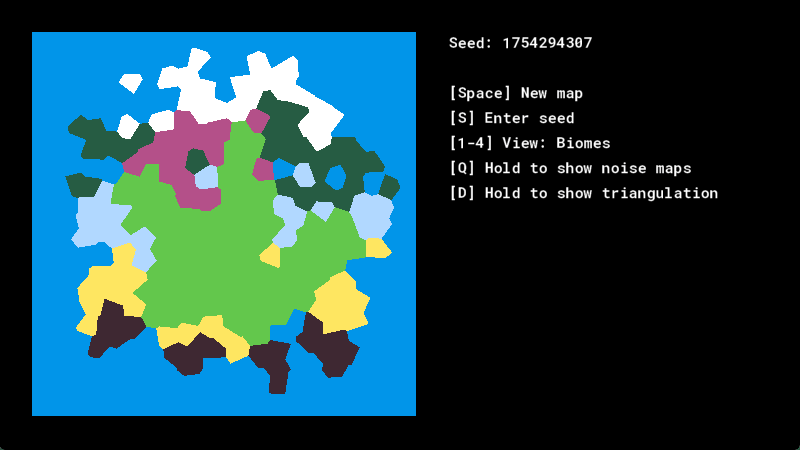

# gml-voronoi

Voronoi diagrams and Delaunay triangulation for GameMaker, with Lloyd relaxation, clipping to a rectangle and a biome map demo



## Usage

```gml
var _w = room_width;
var _h = room_height;

points = [];
repeat (300) {
    array_push(points, { x: random(_w), y: random(_h) });
}

// Far-away points around the room, so every point inside gets a closed cell
var _bounds = [
    { x: -_w, y: -_h }, { x: 2 * _w, y: -_h },
    { x: -_w, y: 2 * _h }, { x: 2 * _w, y: 2 * _h },
];

var _triangulation = delaunay_bowyer_watson(array_concat(points, _bounds));
cells = voronoi_from_delaunay(points, _triangulation);
voronoi_in_rect(cells, 0, 0, _w, _h);
```

Each cell is `{ site, polygon }`: `site` is your point, `polygon` an array of `[a, b]` edges

```gml
for (var _i = 0; _i < array_length(cells); ++_i) {
    var _polygon = cells[_i].polygon;
    for (var _j = 0; _j < array_length(_polygon); ++_j) {
        var _edge = _polygon[_j];
        draw_line(_edge[0].x, _edge[0].y, _edge[1].x, _edge[1].y);
    }
}
```

For more even cells, replace the points with `lloyd_relaxation(cells)` and build the diagram again. The demo does this three times

| Function                                             | Description                                                                     |
| ---------------------------------------------------- | ------------------------------------------------------------------------------- |
| `delaunay_bowyer_watson(points, [margin])`         | Triangulates the points                                                         |
| `voronoi_from_delaunay(points, triangulation)`     | Cells for the given points                                                      |
| `voronoi_in_rect(cells, left, top, right, bottom)` | Clips the cells in place, drops the ones outside and moves sites inside         |
| `lloyd_relaxation(cells)`                          | New points at the centroid of every cell. Clip the cells first                  |
| `new VoronoiHalton(base, [seed])`                  | `get_next()` returns the next number in [0, 1). Use bases 2 and 3 for x and y |

The triangulation takes quadratic time, and duplicate points aren't supported

### Demo

Run `rmTest`. **Space** makes a new map, **S** enters a seed, **1-4** switch between the biome, elevation, temperature and precipitation views, and holding **Q** or **D** shows the noise maps or the triangulation

## Compatibility

- A recent GameMaker version. The project was last saved with IDE 2026.0.0.16
- Tested on desktop and HTML5

## Credits

The demo's noise shader is classic Perlin noise from [webgl-noise](https://github.com/stegu/webgl-noise) by Stefan Gustavson and Ashima Arts, adapted for GameMaker by Cem Baspinar and `@aft`

## License

MIT, see [LICENSE](LICENSE). The noise shader keeps its own license, see [NOTICE](NOTICE)
